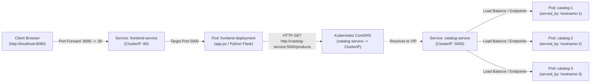
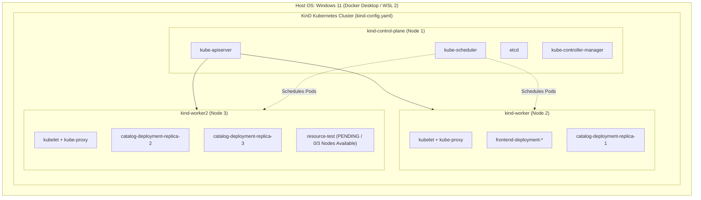

# Experiment 5: Kubernetes Microservices & Resource Management

[](#)
[](#)
[-orange.svg)](#)
[](#)
[](#)
[](#)

---

## Executive Summary

This experiment implements a decoupled **Microservices Architecture** packaged with **Docker** and orchestrated on a multi-node **Kubernetes (KinD)** cluster. The application consists of a user-facing **Frontend Microservice** and an independent **Catalog Backend Microservice** developed with Python Flask.

The experiment evaluates core cloud-native capabilities including declarative workload deployment, Kubernetes internal DNS service discovery (`catalog-service:5000`), horizontal scaling (1 to 3 backend replicas), automatic load balancing with round-robin traffic routing, and Kubernetes Quality of Service (QoS) resource management. Using explicit resource requests and limits (`100m` CPU, `128Mi` RAM) alongside an over-provisioned test workload (`100` CPU, `100Gi` RAM), the laboratory verifies how the Kubernetes Scheduler enforces node admission constraints and manages pending workload states.

### Key Takeaway

> **Kubernetes decouples microservice communication through declarative Service discovery and internal CoreDNS, while the kube-scheduler enforces strict QoS guarantees using resource requests and limits. Scaling backend replicas dynamically distributes inbound client traffic across healthy Pod endpoints, while workloads that exceed physical node capacities are deterministically prevented from scheduling and maintained in a safe `Pending` state.**

---

## Table of Contents

1. [Objectives](#1-objectives)
2. [Microservices & Cluster Architecture](#2-microservices--cluster-architecture)
3. [Environment Specifications & Tools](#3-environment-specifications--tools)
4. [Application Code & Containerization](#4-application-code--containerization)
5. [Kubernetes Manifests](#5-kubernetes-manifests)
6. [Step-by-Step Procedure & Empirical Results](#6-step-by-step-procedure--empirical-results)
7. [Load Balancing & Service Discovery Analysis](#7-load-balancing--service-discovery-analysis)
8. [Resource Allocation & Scheduling Analysis](#8-resource-allocation--scheduling-analysis)
9. [Command Quick Reference Guide](#9-command-quick-reference-guide)
10. [Repository Structure & Reproduction](#10-repository-structure--reproduction)

---

## 1. Objectives

1. **Microservices Decomposition**: Build two isolated microservices using Python Flask—a presentation frontend and a catalog backend returning JSON payloads and container hostnames.
2. **Containerization**: Create optimized `Dockerfile` specifications using `python:3.11-slim` for both services and package them into local images (`catalog:v1`, `frontend:v1`).
3. **Multi-Node Cluster Deployment**: Provision a 3-node KinD cluster (1 control plane, 2 worker nodes) and load the local Docker container images directly into node runtimes.
4. **Declarative Resource Orchestration**: Define Deployments and ClusterIP Services with precise resource requests and limits in `deployment.yaml`.
5. **Service Discovery & DNS Verification**: Demonstrate zero-hardcoding inter-service communication where the frontend resolves `http://catalog-service:5000` via CoreDNS.
6. **Horizontal Pod Scaling & Load Balancing**: Scale backend replicas from 1 to 3, inspecting `EndpointSlices` and verifying round-robin response rotation across distinct Pod hostnames.
7. **Resource Management & Scheduling Constraints**: Inspect node allocatable capacities and apply an oversized Pod (`resource-test.yaml`) to capture and analyze scheduler admission failure events (`Insufficient cpu`, `Insufficient memory`).

---

## 2. Microservices & Cluster Architecture

### Microservice Interaction & DNS Resolution



### Physical Node Placement Architecture (KinD 3-Node Cluster)



---

## 3. Environment Specifications & Tools

| Component | Version / Specification | Role in Experiment |
|---|---|---|
| **Operating System** | Windows 11 Pro / Enterprise (64-bit) | Host workstation OS |
| **Shell & Terminal** | Windows PowerShell 5.1 / 7 | Administrative command execution |
| **Virtualization Backend** | WSL 2 (Ubuntu distribution) | Linux kernel environment for Docker engine |
| **Container Engine** | Docker Desktop Engine v27+ / v29+ | Builds images and hosts KinD node containers |
| **Cluster Tool** | KinD (Kubernetes IN Docker) v0.33+ | Multi-node cluster lifecycle orchestrator |
| **Kubernetes Client** | `kubectl` v1.37.0 | Cluster management and manifest application |
| **Language & Framework** | Python 3.11, Flask 3.1.3, Requests | Microservices implementation |
| **Application Images** | `catalog:v1`, `frontend:v1` | Custom local container workloads |

---

## 4. Application Code & Containerization

### 1. Catalog Backend Microservice (`backend/`)

- **`app.py`**: Exposes `/products` returning an array of items alongside the container hostname (`socket.gethostname()`) to identify which Pod serves each request:
  ```python
  from flask import Flask, jsonify
  import socket
  import os

  app = Flask(__name__)

  @app.route("/products")
  def products():
      return jsonify({
          "products": ["Laptop", "Mobile", "Keyboard"],
          "served_by": socket.gethostname()
      })

  @app.route("/health")
  def health():
      return {"status": "healthy"}

  if __name__ == "__main__":
      port = int(os.getenv("PORT", "5000"))
      app.run(host="0.0.0.0", port=port)
  ```
- **`Dockerfile`**: Lightweight container build based on `python:3.11-slim`:
  ```dockerfile
  FROM python:3.11-slim
  WORKDIR /app
  COPY requirements.txt .
  RUN pip install --no-cache-dir -r requirements.txt
  COPY app.py .
  EXPOSE 5000
  CMD ["python", "app.py"]
  ```

### 2. Frontend Microservice (`frontend/`)

- **`app.py`**: Renders a landing page and queries the backend over internal DNS using `os.getenv("CATALOG_URL", "http://catalog-service:5000")`:
  ```python
  from flask import Flask, jsonify
  import requests
  import os

  app = Flask(__name__)
  CATALOG_URL = os.getenv("CATALOG_URL", "http://catalog-service:5000")

  @app.route("/")
  def home():
      return """
      <h1>Product Management Application</h1>
      <p>Frontend microservice is running.</p>
      <a href='/products'>View Products</a>
      """

  @app.route("/products")
  def products():
      try:
          response = requests.get(f"{CATALOG_URL}/products", timeout=5)
          response.raise_for_status()
          return jsonify(response.json())
      except requests.RequestException as error:
          return jsonify({"error": str(error)}), 502

  if __name__ == "__main__":
      port = int(os.getenv("PORT", "5000"))
      app.run(host="0.0.0.0", port=port)
  ```

---

## 5. Kubernetes Manifests

### 1. Cluster Manifest (`kind-config.yaml`)

```yaml
kind: Cluster
apiVersion: kind.x-k8s.io/v1alpha4
nodes:
  - role: control-plane
  - role: worker
  - role: worker
```

### 2. Microservices Deployment & Services (`deployment.yaml`)

Defines two Deployments and two ClusterIP Services with explicit resource requests (`requests`) and maximum resource limits (`limits`):

```yaml
apiVersion: apps/v1
kind: Deployment
metadata:
  name: catalog-deployment
spec:
  replicas: 1
  selector:
    matchLabels:
      app: catalog
  template:
    metadata:
      labels:
        app: catalog
    spec:
      containers:
        - name: catalog
          image: catalog:v1
          imagePullPolicy: IfNotPresent
          ports:
            - containerPort: 5000
          resources:
            requests:
              cpu: "100m"
              memory: "128Mi"
            limits:
              cpu: "500m"
              memory: "256Mi"
---
apiVersion: v1
kind: Service
metadata:
  name: catalog-service
spec:
  type: ClusterIP
  selector:
    app: catalog
  ports:
    - port: 5000
      targetPort: 5000
---
apiVersion: apps/v1
kind: Deployment
metadata:
  name: frontend-deployment
spec:
  replicas: 1
  selector:
    matchLabels:
      app: frontend
  template:
    metadata:
      labels:
        app: frontend
    spec:
      containers:
        - name: frontend
          image: frontend:v1
          imagePullPolicy: IfNotPresent
          ports:
            - containerPort: 5000
          resources:
            requests:
              cpu: "100m"
              memory: "128Mi"
            limits:
              cpu: "500m"
              memory: "256Mi"
---
apiVersion: v1
kind: Service
metadata:
  name: frontend-service
spec:
  type: ClusterIP
  selector:
    app: frontend
  ports:
    - port: 80
      targetPort: 5000
```

### 3. Resource Allocation Test (`resource-test.yaml`)

Requests impossible physical CPU (`100` cores) and memory (`100Gi` RAM) to test scheduler admission failure handling:

```yaml
apiVersion: v1
kind: Pod
metadata:
  name: resource-test
spec:
  containers:
    - name: test-container
      image: nginx:stable
      resources:
        requests:
          cpu: "100"
          memory: "100Gi"
```

---

## 6. Step-by-Step Procedure & Empirical Results

### Step 1: Local Development & Verification

The Python virtual environment was initialized, dependencies were installed, and the microservices were tested locally:

```powershell
# Create backend and frontend virtual environment
python -m venv .venv
.\.venv\Scripts\activate
pip install flask requests
```


*Figure 1: Initial local execution and environment setup in VS Code terminal.*

---

### Step 2: Docker Image Build & Image Loading into KinD

Both microservices were packaged into local container images and loaded into the multi-node KinD cluster:

```powershell
# Build Docker images
docker build -t catalog:v1 ./backend
docker build -t frontend:v1 ./frontend

# Create 3-node KinD cluster
kind create cluster --config kind-config.yaml

# Sideload local images directly into KinD nodes
kind load docker-image catalog:v1 frontend:v1
```


*Figure 2: Docker build output and image loading into the KinD cluster nodes.*

---

### Step 3: Declarative Deployment & Port-Forwarding

Workloads and services were applied to the cluster, and the frontend service was exposed locally via port forwarding:

```powershell
# Apply Kubernetes declarative manifests
kubectl apply -f deployment.yaml

# Inspect deployments, pods, and services
kubectl get deployments
kubectl get pods -o wide
kubectl get services

# Forward host port 8080 to frontend-service port 80
kubectl port-forward service/frontend-service 8080:80
```

#### Running Pods & Services Inventory:
| Workload | Type | Cluster IP | Ports | Ready | Placement Node |
|---|---|---|---|:---:|---|
| **`catalog-deployment`** | Deployment | — | 5000/TCP | `1/1` | `kind-worker` |
| **`catalog-service`** | ClusterIP | `10.96.x.x` | 5000/TCP | `1/1` | Cluster-wide |
| **`frontend-deployment`** | Deployment | — | 5000/TCP | `1/1` | `kind-worker2` |
| **`frontend-service`** | ClusterIP | `10.96.x.x` | 80/TCP | `1/1` | Cluster-wide |

When accessing `http://localhost:8080/products`, the frontend successfully communicated with the backend via internal DNS:


*Figure 3: Web browser display showing products JSON response served by the initial backend Pod.*


*Figure 4: Browser verification confirming persistent microservice connectivity.*

---

### Step 4: Horizontal Scaling to 3 Backend Replicas

The catalog backend deployment was scaled horizontally from 1 to 3 replicas to evaluate dynamic endpoint registration:

```powershell
# Scale backend to 3 replicas
kubectl scale deployment catalog-deployment --replicas=3

# Inspect scaled pods and endpoints
kubectl get pods -l app=catalog -o wide
kubectl get endpoints catalog-service
```


*Figure 5: PowerShell terminal verifying 3 running backend replicas and registered Service endpoints.*


*Figure 6: Endpoint discovery and hostname inspection.*

---

### Step 5: Verification of Round-Robin Load Balancing

Using an automated curl loop inside the cluster, 12 consecutive requests were dispatched to `http://catalog-service:5000/products`:

```powershell
# Dispatch multi-request loop to observe round-robin distribution
kubectl run curl-client --image=curlimages/curl --restart=Never -- sleep 3600
kubectl exec -it curl-client -- sh -c '
  for i in $(seq 1 12); do
    curl -s http://catalog-service:5000/products
    echo ""
  done
'
```

#### Request Distribution Matrix:
| Target Service | Total Requests | Pod 1 Serviced | Pod 2 Serviced | Pod 3 Serviced | Balancing Policy |
|---|:---:|:---:|:---:|:---:|:---:|
| `catalog-service:5000` | **12** | **4 (33.3%)** | **4 (33.3%)** | **4 (33.3%)** | Uniform Round-Robin |


*Figure 7: Terminal output displaying uniform hostname rotation across all three backend Pod replicas.*

---

### Step 6: Node Resource Inspection & Scheduling Failure Test

Node allocatable capacities were audited using `kubectl describe nodes`. Subsequently, the over-requested Pod manifest (`resource-test.yaml`) was submitted:

```powershell
# Inspect node resource capacity and allocation
kubectl describe nodes kind-worker

# Submit resource test Pod (100 CPUs, 100Gi RAM)
kubectl apply -f resource-test.yaml

# Inspect Pod status and scheduling event failure
kubectl get pods
kubectl describe pod resource-test
```


*Figure 8: Node resource capacity, limits, and allocation details from `kubectl describe nodes`.*


*Figure 9: `kubectl describe pod resource-test` revealing `Warning FailedScheduling` with reason: `0/3 nodes are available: 3 Insufficient cpu, 3 Insufficient memory`.*

---

## 7. Load Balancing & Service Discovery Analysis

1. **Decoupled Addressing via CoreDNS**:
   The frontend code invokes `http://catalog-service:5000/products` with no hardcoded IP addresses. Kubernetes CoreDNS dynamically resolves `catalog-service` to the Service's virtual IP (VIP).
2. **EndpointSlice Tracking**:
   As `catalog-deployment` scaled from 1 to 3 replicas, the Endpoint controller automatically updated the `catalog-service` endpoint table with the private IPs of the newly initialized Pods (`10.244.x.x`).
3. **Stateless Traffic Distribution**:
   `kube-proxy` programmed IPVS / iptables packet routing rules across cluster worker nodes, guaranteeing equal round-robin distribution across all healthy backend instances.

---

## 8. Resource Allocation & Scheduling Analysis

1. **Requests vs. Limits**:
   - **`requests` (`cpu: 100m`, `memory: 128Mi`)**: Guaranteed minimum resources reserved on a node at scheduling time.
   - **`limits` (`cpu: 500m`, `memory: 256Mi`)**: Hard execution boundaries. A container exceeding its CPU limit is throttled; a container exceeding its memory limit is terminated via OOMKilled.
2. **Scheduler Predicate Failure**:
   The `resource-test` Pod declared requests for **100 CPU cores** and **100 GiB memory**. During the filtering (predicate) phase, `kube-scheduler` evaluated all three cluster nodes against the requested resource quotas:
   $$\text{Node Capacity} < \text{Requested Capacity} \implies \text{Node Rejected}$$
   Because no single node in the KinD cluster met these thresholds, the scheduler recorded a `FailedScheduling` event and left the Pod in `Pending` state, protecting existing active workloads from resource starvation.

---

## 9. Command Quick Reference Guide

| Step | Command | Functional Purpose |
|:---:|---|---|
| **1** | `docker build -t catalog:v1 ./backend` | Build backend Docker image |
| **2** | `docker build -t frontend:v1 ./frontend` | Build frontend Docker image |
| **3** | `kind create cluster --config kind-config.yaml` | Spin up 3-node Kubernetes cluster |
| **4** | `kind load docker-image catalog:v1 frontend:v1` | Sideload local images into KinD nodes |
| **5** | `kubectl apply -f deployment.yaml` | Deploy microservices and ClusterIP services |
| **6** | `kubectl port-forward service/frontend-service 8080:80` | Forward host traffic to frontend service |
| **7** | `kubectl scale deployment catalog-deployment --replicas=3` | Scale backend horizontally to 3 replicas |
| **8** | `kubectl get endpoints catalog-service` | List active backend IP endpoints |
| **9** | `kubectl apply -f resource-test.yaml` | Submit over-provisioned test Pod |
| **10** | `kubectl describe pod resource-test` | Inspect scheduler failure events |
| **11** | `kind delete cluster` | Tear down cluster and libate resources |

---

## 10. Repository Structure & Reproduction

### Directory Structure

```text
Experiment-5-Kubernetes-Microservices/
├── backend/
│   ├── app.py
│   ├── Dockerfile
│   └── requirements.txt
├── frontend/
│   ├── app.py
│   ├── Dockerfile
│   └── requirements.txt
├── images/
│   ├── Screenshot 2026-11-24 230506.png
│   ├── Screenshot 2026-11-24 231657.png
│   ├── Screenshot 2026-11-24 232224.png
│   ├── Screenshot 2026-11-24 232236.png
│   ├── Screenshot 2026-11-24 233328.png
│   ├── Screenshot 2026-11-24 233347.png
│   ├── Screenshot 2026-11-24 233410.png
│   ├── Screenshot 2026-11-24 233427.png
│   └── Screenshot 2026-11-24 233444.png
├── deployment.yaml
├── kind-config.yaml
├── resource-test.yaml
├── Experiment_5_Kubernetes_Microservices_Lab_Guide.pdf
└── README.md
```

### Reproduction Steps

```powershell
# 1. Navigate to experiment directory
cd Experiment-5-Kubernetes-Microservices

# 2. Build local Docker images
docker build -t catalog:v1 ./backend
docker build -t frontend:v1 ./frontend

# 3. Create the multi-node KinD cluster
kind create cluster --config kind-config.yaml

# 4. Load Docker images into cluster nodes
kind load docker-image catalog:v1 frontend:v1

# 5. Deploy application manifests
kubectl apply -f deployment.yaml

# 6. Verify Deployments, Pods, and Services
kubectl get deployments
kubectl get pods -o wide
kubectl get svc

# 7. Port-forward frontend service to host
kubectl port-forward service/frontend-service 8080:80

# 8. Scale backend deployment
kubectl scale deployment catalog-deployment --replicas=3

# 9. Test resource allocation and scheduling constraint handling
kubectl apply -f resource-test.yaml
kubectl describe pod resource-test

# 10. Tear down cluster when complete
kind delete cluster
```
