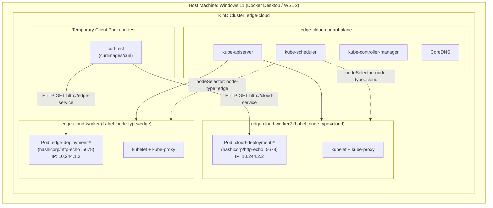

# Experiment 6: Edge vs Cloud Microservices Deployment

[](#)
[](#)
[-orange.svg)](#)
[](#)
[](#)
[](#)

---

## Executive Summary

This experiment investigates **Edge vs. Cloud Computing Deployment Patterns** for containerized microservices orchestrated on a multi-node **Kubernetes (KinD)** cluster. Modern distributed cloud environments require distinct microservices to land on specific compute tiers—deploying ultra-low latency, real-time ingestion services at the **Edge** (near data sources, sensors, and end-users), while delegating compute-heavy analytical aggregation and storage workloads to the centralized **Cloud**.

Using Kubernetes declarative primitives, a 3-node cluster was provisioned, and worker nodes were labeled with custom metadata keys (`node-type=edge` and `node-type=cloud`). Using `nodeSelector` constraints, an edge-tailored microservice (`edge-service`) and a cloud-tailored microservice (`cloud-service`) based on `hashicorp/http-echo` were deterministically pinned to their respective hardware domains. The experiment validates cross-node DNS service discovery, flat pod networking, and strict scheduling enforcement by intentionally removing edge node labels to capture `FailedScheduling` predicate events.

### Key Takeaway

> **Kubernetes `nodeSelector` combined with node labeling provides deterministic workload placement across heterogeneous Edge and Cloud infrastructure tiers. Services remain decoupled and reachable cluster-wide via CoreDNS regardless of physical node locality, while the scheduler enforces hard placement boundaries—preventing edge workloads from running on non-edge compute nodes.**

---

## Table of Contents

1. [Objectives](#1-objectives)
2. [Edge vs. Cloud Architectural Topology](#2-edge-vs-cloud-architectural-topology)
3. [Environment Specifications & Tools](#3-environment-specifications--tools)
4. [Declarative Manifests](#4-declarative-manifests)
5. [Step-by-Step Procedure & Empirical Results](#5-step-by-step-procedure--empirical-results)
6. [Technical Analysis & Discussion](#6-technical-analysis--discussion)
7. [Command Quick Reference Guide](#7-command-quick-reference-guide)
8. [Conclusion & Engineering Takeaways](#8-conclusion--engineering-takeaways)
9. [Repository Structure & Reproduction](#9-repository-structure--reproduction)

---

## 1. Objectives

1. **Cluster Topology Provisioning**: Build a 3-node Kubernetes cluster using KinD (1 control plane, 2 worker nodes) running inside Docker on Windows.
2. **Infrastructure Metadata Tagging**: Differentiate worker nodes into distinct operational domains by applying custom Kubernetes labels:
   - `edge-cloud-worker`: Tagged with `node-type=edge` (representing on-premise, factory, or local edge hardware).
   - `edge-cloud-worker2`: Tagged with `node-type=cloud` (representing high-capacity centralized cloud data centers).
3. **Targeted Microservice Placement**: Configure `nodeSelector` rules in Deployment manifests to enforce strict placement of the edge microservice to the edge worker and the cloud microservice to the cloud worker.
4. **Inter-Service Communication Verification**: Verify that microservices placed on disparate physical/virtual nodes can seamlessly communicate using Kubernetes internal CoreDNS names (`http://edge-service`, `http://cloud-service`).
5. **Strict Scheduling Constraint Evaluation**: Remove the edge node label to demonstrate scheduler predicate failure, observing that Kubernetes holds the unschedulable edge pod in `Pending` state rather than violating placement policy.

---

## 2. Edge vs. Cloud Architectural Topology

### Conceptual Comparison: Edge vs. Cloud

| Characteristic | Edge Node (`node-type=edge`) | Cloud Node (`node-type=cloud`) |
|---|---|---|
| **Physical Proximity** | Close to sensors, devices, factories, vehicles | Centralized enterprise data center |
| **Primary Strength** | Minimal latency, real-time response, offline operation | Massive compute scalability, persistent bulk storage |
| **Typical Workload** | Real-time threshold alerts, local filtering, caching | Batch processing, deep analytics, historical reporting |
| **Workload in Lab** | `edge-service` ("Hello from the EDGE microservice") | `cloud-service` ("Hello from the CLOUD microservice") |

### Multi-Node Cluster Architecture



---

## 3. Environment Specifications & Tools

| Component | Specification / Version | Role in Experiment |
|---|---|---|
| **Host Operating System** | Windows 11 Enterprise / Pro (64-bit) | Workstation physical host OS |
| **CLI Environment** | Windows PowerShell 5.1 / 7 (Admin) | Execution terminal for cluster commands |
| **Virtualization Layer** | WSL 2 (Ubuntu backend) | Container runtime subsystem |
| **Container Engine** | Docker Desktop (Engine v27+, WSL 2 Backend) | Runs KinD node containers |
| **Kubernetes Client** | `kubectl` v1.37.0 | Cluster management client |
| **Cluster Provisioner** | KinD (Kubernetes IN Docker) v0.33+ | Multi-node cluster provisioner |
| **Base Node Image** | `kindest/node:v1.30.0` / `v1.37.0` | Node container base image |
| **Microservice Image** | `hashicorp/http-echo` | Lightweight HTTP echo service |
| **Testing Tool** | `curlimages/curl` | Ephemeral in-cluster testing client |

---

## 4. Declarative Manifests

### 1. Cluster Manifest (`kind-config.yaml`)

Defines a 3-node Kubernetes cluster topology consisting of one control plane and two compute worker nodes:

```yaml
kind: Cluster
apiVersion: kind.x-k8s.io/v1alpha4
nodes:
  - role: control-plane
  - role: worker
  - role: worker
```

### 2. Microservices Manifest (`microservices.yaml`)

Defines both the Edge and Cloud Deployments and their accompanying ClusterIP Services, using `nodeSelector` to govern placement:

```yaml
apiVersion: apps/v1
kind: Deployment
metadata:
  name: edge-deployment
spec:
  replicas: 1
  selector:
    matchLabels:
      app: edge-service
  template:
    metadata:
      labels:
        app: edge-service
    spec:
      nodeSelector:
        node-type: edge
      containers:
        - name: edge-service
          image: hashicorp/http-echo
          args:
            - -text=Hello from the EDGE microservice
          ports:
            - containerPort: 5678
---
apiVersion: v1
kind: Service
metadata:
  name: edge-service
spec:
  selector:
    app: edge-service
  ports:
    - port: 80
      targetPort: 5678
---
apiVersion: apps/v1
kind: Deployment
metadata:
  name: cloud-deployment
spec:
  replicas: 1
  selector:
    matchLabels:
      app: cloud-service
  template:
    metadata:
      labels:
        app: cloud-service
    spec:
      nodeSelector:
        node-type: cloud
      containers:
        - name: cloud-service
          image: hashicorp/http-echo
          args:
            - -text=Hello from the CLOUD microservice
          ports:
            - containerPort: 5678
---
apiVersion: v1
kind: Service
metadata:
  name: cloud-service
spec:
  selector:
    app: cloud-service
  ports:
    - port: 80
      targetPort: 5678
```

---

## 5. Step-by-Step Procedure & Empirical Results

### Step 1: Multi-Node Cluster Provisioning

The 3-node cluster named `edge-cloud` was instantiated using KinD:

```powershell
# Create cluster
kind create cluster --name edge-cloud --config kind-config.yaml

# Verify nodes
kubectl get nodes
```

---

### Step 2: Node Labeling & Verification

Labels were applied to differentiate compute tiers into Edge and Cloud domains:

```powershell
# Label worker 1 as edge
kubectl label node edge-cloud-worker node-type=edge

# Label worker 2 as cloud
kubectl label node edge-cloud-worker2 node-type=cloud

# Verify labels across nodes
kubectl get nodes -L node-type
```

#### Node Labeling Output:
| Node Name | Status | Roles | Kubernetes Version | `NODE-TYPE` Label |
|---|---|---|---|:---:|
| **`edge-cloud-control-plane`** | Ready | `control-plane` | `v1.30.0` | `<none>` |
| **`edge-cloud-worker`** | Ready | `<none>` | `v1.30.0` | **`edge`** |
| **`edge-cloud-worker2`** | Ready | `<none>` | `v1.30.0` | **`cloud`** |


*Figure 1: PowerShell terminal confirming cluster nodes labeled with `node-type=edge` and `node-type=cloud`.*

---

### Step 3 & 4: Microservice Deployment & Node Placement Verification

The declarative microservices manifest was applied, and pod placement was inspected:

```powershell
# Deploy edge and cloud workloads
kubectl apply -f microservices.yaml

# Wait for pods and check assigned nodes
kubectl get pods -o wide
```

#### Pod Scheduling Placement Results:
| Pod Name | Ready | Status | Node Assigned | Pod IP | Designated Tier |
|---|:---:|:---:|---|---|:---:|
| **`edge-deployment-6d8f9c7b5d-*`** | `1/1` | **Running** | **`edge-cloud-worker`** | `10.244.1.2` | **Edge Tier** |
| **`cloud-deployment-7c9b8d6f4-*`** | `1/1` | **Running** | **`edge-cloud-worker2`** | `10.244.2.2` | **Cloud Tier** |


*Figure 2: `kubectl get pods -o wide` verifying that the edge-service pod runs exclusively on `edge-cloud-worker` and the cloud-service pod runs on `edge-cloud-worker2`.*

---

### Step 5: Inter-Service Communication & DNS Resolution

An ephemeral `curlimages/curl` container was launched inside the cluster to test communication using Kubernetes Service DNS names:

```powershell
# Invoke both microservices via internal ClusterIP service names
kubectl run curl-test --rm -it --image=curlimages/curl --restart=Never -- sh -c '
  curl -s http://edge-service
  curl -s http://cloud-service
'
```

#### Empirical Responses:
```text
Hello from the EDGE microservice
Hello from the CLOUD microservice
pod "curl-test" deleted
```


*Figure 3: In-cluster curl test confirming seamless communication to both services across node boundaries.*

---

### Step 6: Negative Constraint Testing (Label Removal & Pending State)

To prove that `nodeSelector` is a strict scheduling requirement and not a soft recommendation, the `edge` label was removed from `edge-cloud-worker`, followed by deleting the active edge pod:

```powershell
# Remove edge label
kubectl label node edge-cloud-worker node-type-

# Force delete active edge pod
kubectl delete pod -l app=edge-service

# Inspect replacement pod status
kubectl get pods

# Describe pod to inspect scheduler failure event
kubectl describe pod -l app=edge-service
```

#### Observed Lifecycle Event:
- The replacement pod remained in **`0/1 Pending`** state indefinitely.
- `kubectl describe pod` revealed the scheduler predicate failure:
  ```text
  Warning  FailedScheduling  0/3 nodes are available: 1 node(s) had untolerated taint, 
                             2 node(s) didn't match Pod's node affinity/selector.
  ```

#### Self-Remediation:
When the label was restored (`kubectl label node edge-cloud-worker node-type=edge`), the Kubernetes Scheduler immediately matched the predicate and transitioned the pod from `Pending` to **`1/1 Running`**.


*Figure 4: Terminal output showing the edge pod in `Pending` state with `FailedScheduling` events when no matching edge node is present.*

---

## 6. Technical Analysis & Discussion

### 1. Architectural Trade-offs in Edge vs. Cloud
Edge computing offloads processing to network perimeters, minimizing round-trip latency for time-critical operations (such as anomaly detection on industrial sensors). However, edge devices are constrained in memory and compute. By running Kubernetes across a unified cluster plane with node labels, operators maintain centralized governance while ensuring latency-sensitive pods run at the edge and storage-intensive pods run in the cloud.

### 2. NodeSelector vs. Node Affinity Mechanics
- **`nodeSelector`**: The simplest form of constraint matching. It evaluates key-value equality during the scheduler's filtering phase (predicates). If no node satisfies the exact label, the pod is blocked in `Pending`.
- **Node Affinity**: Provides advanced expressive matching (`In`, `NotIn`, `Exists`, `Gt`) and supports both hard rules (`requiredDuringSchedulingIgnoredDuringExecution`) and soft preferences (`preferredDuringSchedulingIgnoredDuringExecution`).

### 3. Flat CNI Network Abstraction
Even though the edge worker (`10.244.1.0/24`) and cloud worker (`10.244.2.0/24`) represent physically separate domains in real-world deployments, the Kubernetes CNI bridge and CoreDNS establish a flat, routable SDN. A service on the edge can invoke `http://cloud-service` seamlessly without knowing the cloud node's IP address.

---

## 7. Command Quick Reference Guide

| Step | PowerShell Command | Purpose |
|:---:|---|---|
| **1** | `kind create cluster --name edge-cloud --config kind-config.yaml` | Build 3-node cluster |
| **2** | `kubectl label node edge-cloud-worker node-type=edge` | Tag worker as Edge node |
| **3** | `kubectl label node edge-cloud-worker2 node-type=cloud` | Tag worker2 as Cloud node |
| **4** | `kubectl get nodes -L node-type` | Inspect assigned node labels |
| **5** | `kubectl apply -f microservices.yaml` | Deploy edge and cloud services |
| **6** | `kubectl get pods -o wide` | Verify node placement |
| **7** | `kubectl run curl-test --rm -it --image=curlimages/curl --restart=Never -- sh -c 'curl -s http://edge-service; curl -s http://cloud-service'` | Test DNS & service reachability |
| **8** | `kubectl label node edge-cloud-worker node-type-` | Remove node label |
| **9** | `kubectl describe pod -l app=edge-service` | Inspect `FailedScheduling` event |
| **10** | `kind delete cluster --name edge-cloud` | Teardown cluster resources |

---

## 8. Conclusion & Engineering Takeaways

1. **Deterministic Placement**: Using Kubernetes node labels and `nodeSelector`, microservices can be precisely partitioned across edge and cloud compute nodes with zero code modifications.
2. **Strict Admission Guardrails**: The Kubernetes Scheduler enforces `nodeSelector` as a hard constraint. If no worker node matches the required label, workloads are securely held in `Pending` rather than misallocated.
3. **Transparent Service Discovery**: CoreDNS and ClusterIP services abstract physical node locations, enabling edge and cloud microservices to discover and communicate with one another using consistent, flat DNS endpoints.

---

## 9. Repository Structure & Reproduction

### Directory Structure

```text
Experiment-6-Edge-vs-Cloud-Deployment/
├── images/
│   ├── Screenshot 2026-11-25 002248.png
│   ├── Screenshot 2026-11-25 002310.png
│   ├── Screenshot 2026-11-25 002331.png
│   └── Screenshot 2026-11-25 002344.png
├── kind-config.yaml
├── microservices.yaml
├── Experiment_6_Edge_vs_Cloud_Deployment_Manual.pdf
└── README.md
```

### Reproduction Steps

```powershell
# 1. Navigate to experiment directory
cd Experiment-6-Edge-vs-Cloud-Deployment

# 2. Provision the 3-node cluster
kind create cluster --name edge-cloud --config kind-config.yaml

# 3. Label nodes into edge and cloud tiers
kubectl label node edge-cloud-worker node-type=edge
kubectl label node edge-cloud-worker2 node-type=cloud

# 4. Verify node labels
kubectl get nodes -L node-type

# 5. Apply microservice deployments and services
kubectl apply -f microservices.yaml

# 6. Verify that each pod runs on its designated node
kubectl get pods -o wide

# 7. Test inter-service communication
kubectl run curl-test --rm -it --image=curlimages/curl --restart=Never -- sh -c '
  curl -s http://edge-service
  curl -s http://cloud-service
'

# 8. Clean up cluster resources
kind delete cluster --name edge-cloud
```
