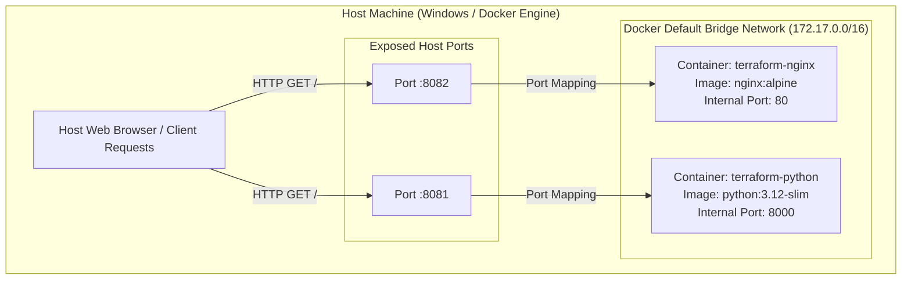
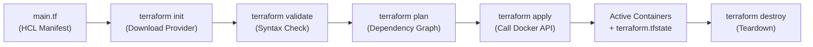

# Multi-Container Provisioning and Orchestration with Terraform & Docker

[](#)
[](#)
[](#)
[](#)
[](#)

---

## Executive Summary

This experiment implements declarative **Infrastructure as Code (IaC)** using **HashiCorp Terraform** to automate the provisioning, lifecycle management, and networking of multiple heterogeneous containerized services on a local **Docker** engine.

Using the `kreuzwerker/docker` provider, Terraform declaratively provisions an **Nginx HTTP Web Server** (`nginx:alpine`) and a lightweight **Python Application Server** (`python:3.12-slim`). The experiment validates automated dependency graph resolution, port mapping, state reconciliation (`terraform.tfstate`), and verified runtime service accessibility on separate host ports (`8082` and `8081`).

### Key Takeaway

> **Terraform enables deterministic, reproducible multi-container provisioning through a unified declarative configuration (`main.tf`). By shifting container orchestration into version-controlled IaC, environment drift is eliminated and multi-tier container topologies can be deployed, updated, and destroyed with atomic lifecycle commands (`init`, `plan`, `apply`, `destroy`).**

---

## Table of Contents

1. [Objectives](#1-objectives)
2. [Architecture & Workflow](#2-architecture--workflow)
3. [Environment Specifications](#3-environment-specifications)
4. [Infrastructure Code (`main.tf`)](#4-infrastructure-code-maintf)
5. [Step-by-Step Procedure](#5-step-by-step-procedure)
6. [Empirical Results & Screenshots](#6-empirical-results--screenshots)
7. [Resource Comparison & Port Allocation Table](#7-resource-comparison--port-allocation-table)
8. [Technical Analysis & Discussion](#8-technical-analysis--discussion)
9. [Conclusion & Engineering Takeaways](#9-conclusion--engineering-takeaways)
10. [Repository Structure & Reproduction](#10-repository-structure--reproduction)

---

## 1. Objectives

1. **Declarative Container Infrastructure**: Define Docker images, container instances, port mappings, and runtime execution commands in HashiCorp Configuration Language (HCL).
2. **Multi-Service Provisioning**: Deploy two distinct container services concurrently:
   - An Alpine-based Nginx high-performance web server.
   - A Python 3.12 slim HTTP file/directory server running `python -m http.server 8000`.
3. **Provider Lifecycle & Locking**: Configure and lock the community-standard `kreuzwerker/docker` provider with `.terraform.lock.hcl`.
4. **State Management & Idempotency**: Utilize `terraform.tfstate` to track resource IDs, network interfaces, and container metadata, validating Terraform's idempotency and drift prevention.
5. **Runtime Verification**: Verify container health, port forwarding, and web service responses via terminal tools (`docker images`, `docker ps`) and web browsers (`localhost:8082`, `localhost:8081`).

---

## 2. Architecture & Workflow

### Multi-Container Topology



### Terraform IaC Lifecycle Pipeline



---

## 3. Environment Specifications

| Parameter | Specification |
|---|---|
| **Host Operating System** | Windows 11 (PowerShell terminal) |
| **IaC Tool** | HashiCorp Terraform v1.16.6 |
| **Terraform Provider** | `kreuzwerker/docker` (version constraint `~> 3.0`, resolved `v3.9.0`) |
| **Container Engine** | Docker Engine (Linux containers via WSL2 / Docker Desktop) |
| **Web Service 1** | Nginx (`nginx:alpine`), Host Port `8082` -> Container Port `80` |
| **Application Service 2** | Python (`python:3.12-slim`), Host Port `8081` -> Container Port `8000` |
| **Network Driver** | `bridge` |

---

## 4. Infrastructure Code (`main.tf`)

The infrastructure is defined declaratively in [`main.tf`](main.tf):

```hcl
terraform {
  required_providers {
    docker = {
      source  = "kreuzwerker/docker"
      version = "~> 3.0"
    }
  }
}

provider "docker" {}

resource "docker_image" "nginx" {
  name = "nginx:alpine"
}

resource "docker_image" "python" {
  name = "python:3.12-slim"
}

resource "docker_container" "webserver" {
  name  = "terraform-nginx"
  image = docker_image.nginx.image_id

  ports {
    internal = 80
    external = 8082
  }
}

resource "docker_container" "python_app" {
  name  = "terraform-python"
  image = docker_image.python.image_id

  command = [
    "python",
    "-m",
    "http.server",
    "8000"
  ]

  ports {
    internal = 8000
    external = 8081
  }
}
```

---

## 5. Step-by-Step Procedure

### Step 1: Initialize Terraform Working Directory

Initializes the provider plugins, queries the HashiCorp registry for `kreuzwerker/docker`, downloads version `3.9.0`, and creates `.terraform.lock.hcl`:

```bash
terraform init
```

### Step 2: Validate and Plan Infrastructure

Validates syntax and constructs the planned dependency execution graph:

```bash
terraform validate
terraform plan
```

### Step 3: Apply Infrastructure

Executes the planned changes against the local Docker Engine, pulls required container images, and provisions the containers:

```bash
terraform apply -auto-approve
```

### Step 4: Verify Deployment via Docker CLI

Inspect active Docker images and running container instances:

```bash
docker images
docker ps
```

### Step 5: Test Service Accessibility

Access both running services using a web browser or curl:
- **Nginx Web Server**: `http://localhost:8082`
- **Python HTTP Server**: `http://localhost:8081`

### Step 6: Teardown (When Experiment Concludes)

Destroy all managed resources cleanly without leaving orphan containers or dangling port bindings:

```bash
terraform destroy -auto-approve
```

---

## 6. Empirical Results & Screenshots

### 1. Terraform Initialization

The `terraform init` command initializes the backend and downloads the `kreuzwerker/docker` provider plugin (`v3.9.0`), creating the dependency lock file `.terraform.lock.hcl`.


*Figure 1: Successful provider initialization (`kreuzwerker/docker v3.9.0`).*

---

### 2. Configuration Validation & Execution Plan

`terraform validate` confirms that all configuration syntax is correct. `terraform plan` compares the desired state in `main.tf` against the existing state, determining that the resource `docker_container.webserver` must be created with port forwarding `8082 -> 80`.


*Figure 2: Validation confirmation and execution plan generation.*

---

### 3. Terraform Apply & Resource Creation

Executing `terraform apply` applies the execution plan. Terraform orchestrates image verification and invokes the Docker API to spin up the container within 1 second.


*Figure 3: Resource application completed (`Apply complete! Resources: 1 added, 0 changed, 0 destroyed`).*

---

### 4. Docker Image Inventory Verification

Inspecting Docker's local image cache demonstrates that `nginx:alpine` and `python:3.12-slim` have been fetched and marked as in-use (`U`) by the running containers.


*Figure 4: Local Docker images showing active in-use status.*

---

### 5. Running Containers & Port Mappings

Running `docker ps` validates that both managed containers (`terraform-nginx` and `terraform-python`) are in `Up` state with correct host-to-container port bindings (`0.0.0.0:8082->80/tcp` and `0.0.0.0:8081->8000/tcp`).


*Figure 5: Active container status and port mappings in Docker runtime.*

---

### 6. Nginx Web Server Verification

Navigating to `http://localhost:8082` in the browser verifies that the `terraform-nginx` container is responding with the official Nginx default landing page.


*Figure 6: Nginx welcome page accessed through host port 8082.*

---

### 7. Python HTTP Application Server Verification

Navigating to `http://localhost:8081` demonstrates that the `terraform-python` container is actively running Python's built-in HTTP server (`python -m http.server 8000`) and serving the root filesystem directory structure.


*Figure 7: Python HTTP server directory listing accessed through host port 8081.*

---

### 8. Container Filesystem Browsing

Detailed browser verification confirming directory traversal and root file access on the containerized Python HTTP server.


*Figure 8: Containerized filesystem tree verification on port 8081.*

---

## 7. Resource Comparison & Port Allocation Table

| Attribute | Web Server Service | Application Server Service |
|---|---|---|
| **Resource Name** | `docker_container.webserver` | `docker_container.python_app` |
| **Container Name** | `terraform-nginx` | `terraform-python` |
| **Base Image** | `nginx:alpine` | `python:3.12-slim` |
| **Internal Port** | `80` | `8000` |
| **Host Port Mapping** | `8082:80` | `8081:8000` |
| **Execution Command** | Default entrypoint (`nginx -g 'daemon off;'`) | `["python", "-m", "http.server", "8000"]` |
| **Network Mode** | `bridge` | `bridge` |
| **Container IP (Internal)** | Dynamically allocated (`172.17.0.x`) | `172.17.0.2` |
| **Lifecycle State** | Managed via Terraform State | Managed via Terraform State |

---

## 8. Technical Analysis & Discussion

### 1. Declarative vs. Imperative Container Management
- **Imperative Approach (`docker run`)**: Requires manually issuing separate sequential commands, manually tracking flags (`-p`, `--name`, `-d`), and handling error recovery. If a container stops or changes, the operator must manually inspect and remediate.
- **Declarative Approach (Terraform)**: Declares the **desired end state** in `main.tf`. Terraform checks the current state (`terraform.tfstate`), calculates the exact delta, and applies only the required changes. Re-running `terraform apply` is completely idempotent.

### 2. Dependency Management via Graph Resolution
Terraform builds a Directed Acyclic Graph (DAG) before applying changes. In this configuration:
- `docker_container.webserver` references `docker_image.nginx.image_id`.
- `docker_container.python_app` references `docker_image.python.image_id`.
Terraform automatically infers that it must pull both images before attempting to invoke the container creation API, avoiding race conditions without requiring explicit `depends_on` blocks.

### 3. Port Mapping & Isolation
Host port collision is a common issue when running multiple services. By abstracting configuration into HCL, port allocations (`8081` and `8082`) are documented directly in source control, preventing port overlap while allowing internal services to run on their standard container ports (`80` and `8000`).

---

## 9. Conclusion & Engineering Takeaways

1. **Automation & Speed**: Terraform provisions and verifies multiple heterogeneous containers in under 2 seconds.
2. **Reproducibility**: Any team member or CI/CD runner can clone this repository, run `terraform apply`, and obtain an identical containerized environment.
3. **Clean Teardown**: Running `terraform destroy` cleanly tears down all containers and liberates mapped host ports, eliminating orphaned processes.
4. **Extensibility**: The same declarative paradigm extends seamlessly to multi-node container orchestrators, cloud registries, and hybrid cloud topologies (AWS ECS, GCP Cloud Run, Azure ACI, or Kubernetes).

---

## 10. Repository Structure & Reproduction

### Directory Structure

```text
Experiment-Terraform-Multi-Containers/
├── images/
│   ├── Screenshot 2026-11-06 043139.png
│   ├── Screenshot 2026-11-06 043145.png
│   ├── Screenshot 2026-11-06 043156.png
│   ├── Screenshot 2026-11-06 043217.png
│   ├── Screenshot 2026-11-06 043232.png
│   ├── Screenshot 2026-11-06 043324.png
│   ├── Screenshot 2026-11-06 043349.png
│   └── Screenshot 2026-11-06 043406.png
├── .terraform.lock.hcl
├── main.tf
├── README.md
└── terraform.tfstate
```

### Reproduction Steps

```bash
# 1. Navigate to the experiment folder
cd Experiment-Terraform-Multi-Containers

# 2. Initialize provider plugins
terraform init

# 3. Validate configuration
terraform validate

# 4. Review planned actions
terraform plan

# 5. Provision the containers
terraform apply -auto-approve

# 6. Verify in browser:
#    - Nginx:  http://localhost:8082
#    - Python: http://localhost:8081

# 7. Destroy infrastructure when finished
terraform destroy -auto-approve
```
