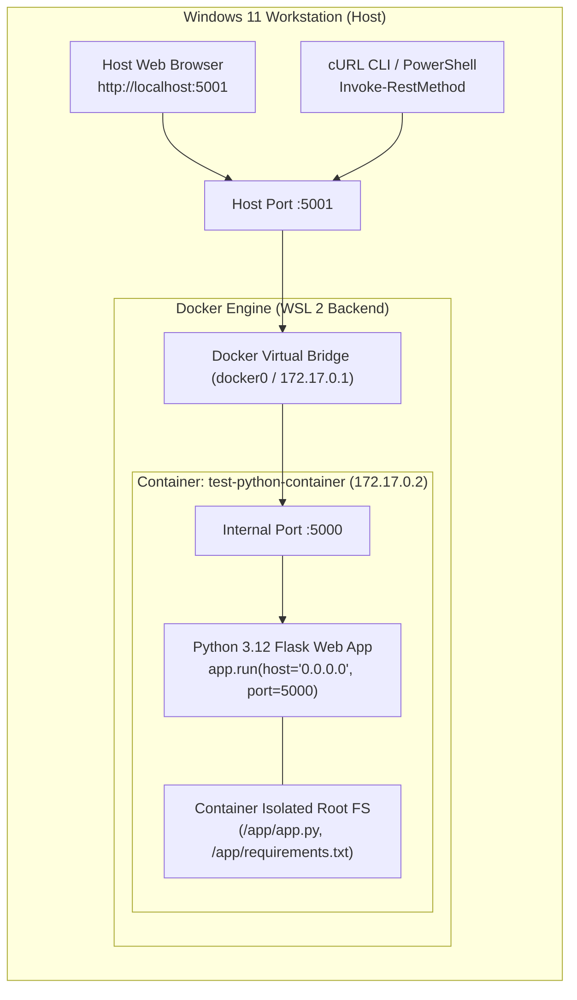
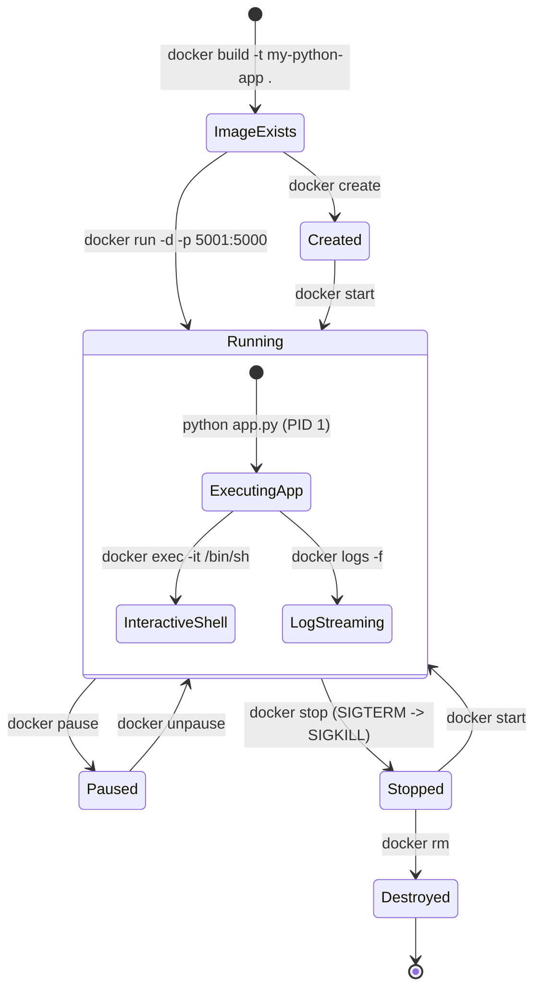
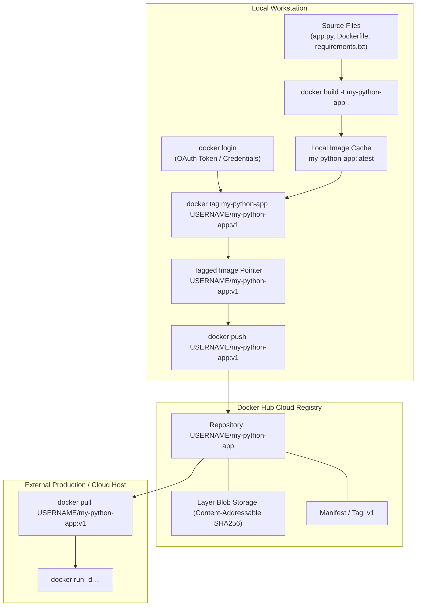

# Docker Containerization, Container Lifecycle Management, and Remote Registry Distribution

[](#)
[](#)
[](#)
[](#)
[](#)

---

## Executive Summary

This lab comprehensively investigates the core tenets of containerization, image construction, runtime lifecycle management, and remote registry distribution using **Docker Engine** on Windows via **Docker Desktop with WSL 2 backend**.

The practical study spans three integrated phases:
1. **Application Packaging & Containerization**: Developing a lightweight Python 3.12 Flask microservice, crafting an optimized multi-step `Dockerfile`, building an immutable container image (`my-python-app:latest`), and establishing host-to-container port mapping (`5001:5000`).
2. **Container Runtime & Lifecycle Management**: Executing deterministic lifecycle operations—including background daemon execution (`-d`), interactive in-container debugging shells (`docker exec -it /bin/sh`), stdout/stderr log stream extraction, metadata inspection (`docker inspect`), orderly shutdown (`docker stop` via `SIGTERM`), and clean teardown (`docker rm`).
3. **Image Distribution & Registry Management**: Authenticating CLI sessions against **Docker Hub**, establishing semantic namespace tagging (`USERNAME/repository:tag`), pushing multi-layer blob manifests over HTTPS, and validating remote image availability for reproducible cross-platform deployments.

### Key Takeaway

> **Docker decouples application dependencies from host operating systems through lightweight, immutable filesystem layers and Linux kernel namespaces. By containerizing a microservice into an OCI-compliant image and managing its state transitions deterministically, applications achieve zero host-dependency drift, predictable startup latency (< 1s), isolated process boundaries, and frictionless cloud-native distribution via Docker Hub.**

---

## Table of Contents

1. [Objectives](#1-objectives)
2. [Architectural Topologies & Lifecycle State Machine](#2-architectural-topologies--lifecycle-state-machine)
3. [Environment Specifications & Tooling](#3-environment-specifications--tooling)
4. [Application Source Code & Container Manifests](#4-application-source-code--container-manifests)
5. [Step-by-Step Procedure & Execution Workflow](#5-step-by-step-procedure--execution-workflow)
   - [Phase 1: Application Containerization & Image Creation](#phase-1-application-containerization--image-creation)
   - [Phase 2: Container Runtime Management, Inspection & Lifecycle](#phase-2-container-runtime-management-inspection--lifecycle)
   - [Phase 3: Docker Hub Remote Registry Distribution](#phase-3-docker-hub-remote-registry-distribution)
6. [Empirical Results & Screenshot Verification](#6-empirical-results--screenshot-verification)
7. [Container Lifecycle State Matrix & CLI Reference](#7-container-lifecycle-state-matrix--cli-reference)
8. [Technical Analysis & Deep-Dive Discussion](#8-technical-analysis--deep-dive-discussion)
9. [Conclusion & Engineering Takeaways](#9-conclusion--engineering-takeaways)
10. [Repository Structure & Reproduction Guide](#10-repository-structure--reproduction-guide)

---

## 1. Objectives

1. **Microservice Development**: Build a minimal, reliable Python HTTP web service using the Flask micro-framework responding on all network interfaces (`0.0.0.0:5000`).
2. **Declarative Container Specification**: Define a reproducible `Dockerfile` employing `python:3.12-slim` as the base image, declaring working directories, managing dependencies via `requirements.txt`, and specifying the default runtime entrypoint.
3. **Image Layer Compilation**: Build the container image using the BuildKit engine, verifying layer caching, digest generation, and immutable artifact registration in the local Docker daemon.
4. **Port Binding & Network Isolation**: Launch containerized instances in detached mode, establishing Network Address Translation (NAT) port forwarding from host port `5001` to internal container port `5000`.
5. **Runtime Lifecycle Verification**: Monitor container state transitions across `Created`, `Up` (Running), `Exited` (Stopped), and `Deleted`, verifying exit codes (`137` for `SIGTERM` / `SIGKILL`) and verifying container ID preservation across restart cycles.
6. **In-Container Troubleshooting**: Execute interactive shells (`/bin/sh`) within running containers to verify filesystem layout, process isolation, and environment variables.
7. **Remote Registry Publication**: Authenticate Docker CLI against Docker Hub, apply target repository tags, upload image layer blobs, and verify public catalog availability.

---

## 2. Architectural Topologies & Lifecycle State Machine

### 2.1 Host-to-Container Network & Port Forwarding

The Docker bridge network (`bridge0` / `docker0`) assigns an isolated internal virtual IP address (`172.17.0.x`) to the container. Port forwarding maps host TCP port `5001` to container TCP port `5000`, enabling external clients (browsers and `curl`) on the Windows host to reach the isolated Flask service.



---

### 2.2 Docker Container Lifecycle State Machine

Containers progress through deterministic lifecycle states managed via Docker CLI commands. The underlying image remains read-only and immutable throughout all operations.



---

### 2.3 Docker Hub Image Distribution Pipeline

The workflow transitions local application source code into a distributed cloud image repository via authentication, tagging, and layer streaming:



---

## 3. Environment Specifications & Tooling

| Component | Version / Specification | Role in Architecture |
|:---|:---|:---|
| **Host Operating System** | Windows 11 Enterprise / Pro (64-bit) | Host physical workstation OS |
| **Virtualization Backend** | WSL 2 (Ubuntu Linux Kernel 5.15+) | Linux kernel compatibility layer providing cgroups and namespaces |
| **Container Engine** | Docker Engine v29.x / Docker Desktop | OCI runtime, daemon, and image builder |
| **Command-Line Interface** | Windows PowerShell 5.1 / 7.x | Terminal shell for scripting and Docker command execution |
| **Language Runtime** | Python 3.12 (Base Image: `python:3.12-slim`) | Lightweight Python interpreter with reduced attack surface |
| **Application Framework** | Flask 3.x | Lightweight WSGI web application framework |
| **Remote Registry** | Docker Hub (`https://hub.docker.com`) | Public container registry for hosting and distributing versioned images |
| **Port Forwarding Scheme** | `5001 (Host) -> 5000 (Container)` | External NAT port translation preventing host port collisions |

---

## 4. Application Source Code & Container Manifests

All application assets are located in the [`docker-python-app/`](docker-python-app/) directory.

### 4.1 Python Web Application (`app.py`)

A minimal Flask microservice serving an HTTP 200 response on the root path (`/`). Binding to `0.0.0.0` is essential to allow requests entering through the Docker virtual bridge network interface.

```python
from flask import Flask

app = Flask(__name__)

@app.route("/")
def home():
    return "Hello! My first Docker application is running."

if __name__ == "__main__":
    app.run(host="0.0.0.0", port=5000)
```

> **Design Note**: Binding explicitly to `127.0.0.1` inside a container restricts access to the container's internal loopback interface, rendering it unreachable from the host. Binding to `0.0.0.0` instructs Flask to listen across all assigned network interfaces.

### 4.2 Python Dependencies (`requirements.txt`)

Specifies the required third-party Python packages:

```text
flask
```

### 4.3 Containerfile Specification (`Dockerfile`)

A multi-instruction container definition adopting cloud-native best practices for caching and minimal layer size:

```dockerfile
FROM python:3.12-slim

WORKDIR /app

COPY requirements.txt .

RUN pip install --no-cache-dir -r requirements.txt

COPY app.py .

EXPOSE 5000

CMD ["python", "app.py"]
```

#### Instruction Breakdown:
- `FROM python:3.12-slim`: Utilizes a Debian-based minimal Python runtime (~150MB), omitting heavy build toolchains to minimize attack surface and image size.
- `WORKDIR /app`: Defines the absolute working directory for subsequent instructions and the runtime container environment.
- `COPY requirements.txt .`: Copies package dependencies independently to take advantage of Docker's layer caching mechanism.
- `RUN pip install -r requirements.txt`: Installs dependencies into the container's system Python environment.
- `COPY app.py .`: Copies application source code in a separate layer, ensuring dependency cache remains valid across application code revisions.
- `EXPOSE 5000`: Documents the expected listening port for container runtimes and human operators.
- `CMD ["python", "app.py"]`: Specifies the default executable and argument vector using the preferred exec format (JSON array), enabling proper POSIX signal propagation (`SIGTERM`).

---

## 5. Step-by-Step Procedure & Execution Workflow

### Phase 1: Application Containerization & Image Creation

#### Step 1: Pre-Flight Docker Engine Verification
Validate that Docker Desktop and the Docker daemon are running properly on Windows:

```powershell
docker --version
docker run hello-world
```

#### Step 2: Project Setup & Asset Creation
Organize the project directory structure and create the application files:

```powershell
mkdir docker-python-app
cd docker-python-app
# Create app.py, requirements.txt, and Dockerfile
```

#### Step 3: Build the Docker Image
Compile the container image from the local context, tagging it as `my-python-app:latest`:

```powershell
docker build -t my-python-app .
```

Docker BuildKit executes the 5 steps sequentially:
1. `[1/5]` Resolves and pulls `python:3.12-slim` base image layers.
2. `[2/5]` Sets the working directory to `/app`.
3. `[3/5]` Copies `requirements.txt` into the layer.
4. `[4/5]` Executes `pip install` to install Flask and its dependencies (`Werkzeug`, `Jinja2`, `itsdangerous`, `click`, `blinker`).
5. `[5/5]` Copies `app.py` and exports the finished image manifest and configuration blobs to the local store.

#### Step 4: Validate Image Registration
Inspect the local image repository to confirm presence, image ID, and disk footprint:

```powershell
docker images
```

---

### Phase 2: Container Runtime Management, Inspection & Lifecycle

#### Step 5: Instantiate and Run the Container in Detached Mode
Launch the container as a background daemon process, binding host port `5001` to container port `5000`:

```powershell
docker run -d -p 5001:5000 --name test-python-container my-python-app
```

#### Step 6: Verify Active Container Runtime State
Check running containers and verify port mappings:

```powershell
docker ps --filter "name=test-python-container"
```

#### Step 7: Test Application Service Accessibility
Test the running application from the command line and browser:
- **cURL HTTP Verification**:
  ```powershell
  curl http://localhost:5001
  ```
  *Expected Output*: `Hello! My first Docker application is running.`
- **Browser Verification**: Navigate to `http://localhost:5001` in Google Chrome or Microsoft Edge.

#### Step 8: Stream Container Logs
Inspect stdout and stderr streams emitted by the Flask application:

```powershell
docker logs test-python-container
```

#### Step 9: Low-Level Metadata Inspection
Retrieve the complete JSON configuration, network properties, and volume attachments:

```powershell
docker inspect test-python-container
```

#### Step 10: Interactive Shell Execution Inside Container
Spawn an interactive `/bin/sh` session inside the running container namespace to inspect isolated files:

```powershell
docker exec -it test-python-container /bin/sh
# Inside container shell:
ls -la
pwd
exit
```

#### Step 11: Stop Container & Inspect Exit State
Send `SIGTERM` (followed by `SIGKILL` after grace period) to orderly terminate the container process:

```powershell
docker stop test-python-container
docker ps -a
```
*Verification*: Status reflects `Exited (137)` indicating signal termination, while preserving container metadata.

#### Step 12: Restart Stopped Container
Validate that stopped containers can be restarted instantly without rebuilding or re-instantiating layers:

```powershell
docker start test-python-container
docker ps
```
*Verification*: The same Container ID resumes execution with intact state and port mappings.

#### Step 13: Clean Teardown and Resource Removal
Gracefully stop and destroy the container instance:

```powershell
docker stop test-python-container
docker rm test-python-container
docker ps -a
```

#### Step 14: Confirm Image Persistence
Validate that deleting container instances does not affect the immutable parent image:

```powershell
docker images
```

---

### Phase 3: Docker Hub Remote Registry Distribution

#### Step 15: Authenticate CLI Session with Docker Hub
Log in to the Docker Hub registry using valid account credentials:

```powershell
docker login
```

#### Step 16: Apply Remote Repository Tag
Create an alias reference targeting the remote Docker Hub repository:

```powershell
docker tag my-python-app USERNAME/my-python-app:v1
docker images
```
*Note*: Tagging creates a new repository pointer sharing the identical Image ID without duplicating disk storage.

#### Step 17: Push Image Layers to Docker Hub
Stream layer blobs and the index manifest over HTTPS to the remote registry:

```powershell
docker push USERNAME/my-python-app:v1
```

#### Step 18: Remote Verification on Docker Hub
Log in to the Docker Hub web portal (`https://hub.docker.com`) and verify that the `my-python-app` repository displays the `v1` tag.

---

## 6. Empirical Results & Screenshot Verification

The following screenshots capture the end-to-end execution, runtime status, and verification stages performed during this lab.

### Figure 1: Project Directory Structure & Application Code Verification

Inspection of `docker-python-app` confirming the presence and contents of `app.py`, `requirements.txt`, and `Dockerfile`:


*Figure 1: PowerShell terminal displaying `dir`, `app.py` Flask code, `requirements.txt`, and `Dockerfile` contents.*

---

### Figure 2: Multi-Stage Docker Image Build Process

Executing `docker build -t my-python-app .` through BuildKit, illustrating layer resolution, package installation, and image artifact export:


*Figure 2: BuildKit 10-step build trace showing base image resolution, cached workdir, pip dependency installation, and export to `docker.io/library/my-python-app:latest`.*

---

### Figure 3: Container Instantiation & Process Verification

Running the container in background mode with `-d` and port mapping `5001:5000`:


*Figure 3: `docker run -d -p 5001:5000 --name my-python-container my-python-app` generating container hash `109eb840bc6c` and confirming `Up 5 seconds` on `0.0.0.0:5001->5000/tcp`.*

---

### Figure 4: Local HTTP Endpoint Verification via cURL

Invoking an HTTP GET request against the forwarded host port `5001` using `curl`:


*Figure 4: `curl http://localhost:5001` returning `Hello! My first Docker application is running.`.*

---

### Figure 5: Web Browser HTTP Verification & Port Forwarding

Side-by-side verification showing Chrome browser rendering the Flask HTTP response alongside active Docker daemon processes:


*Figure 5: Web browser rendering `localhost:5001` with greeting text alongside PowerShell terminal running `docker run` and `docker ps`.*

---

### Figure 6: Container Runtime Status & Port Binding Inspection

Detailed inspection of running container properties, process commands, and port bindings:


*Figure 6: Process verification of `test-python-container` running `python app.py` mapped to `0.0.0.0:5001->5000/tcp`.*

---

### Figure 7: Interactive In-Container Shell & Filesystem Exploration

Executing `docker exec -it test-python-container /bin/sh` to inspect the isolated container filesystem:


*Figure 7: Interactive shell session inside the container verifying working directory `/app` and isolated files `app.py` and `requirements.txt`.*

---

### Figure 8: Container Termination & Process Exit State

Halting the active container using `docker stop test-python-container`:


*Figure 8: Issuing `docker stop test-python-container` and verifying removal from the active container list (`docker ps`).*

---

### Figure 9: Stopped Container Inspection & Exit Code Verification

Listing all containers (including terminated instances) using `docker ps -a`:


*Figure 9: `docker ps -a` confirming `Exited (137) 21 seconds ago`, validating graceful signal handling.*

---

### Figure 10: Container Restart, Idempotent Re-execution & Clean Teardown

Demonstrating container re-activation (`docker start`), re-stopping, and permanent deletion (`docker rm`):


*Figure 10: Complete lifecycle transitions: restarting the stopped container (`docker start`), subsequent stop, removal (`docker rm`), and confirming clean state via `docker ps -a`.*

---

### Figure 11: Image Cache & Repository Tag Verification

Inspecting Docker's local image storage cache to verify image persistence across container lifecycles:


*Figure 11: `docker images` inventory verifying `my-python-app:latest` and existing repositories with content sizes and image IDs.*

---

## 7. Container Lifecycle State Matrix & CLI Reference

| Command | Lifecycle Phase | Impact on Container | Impact on Image |
|:---|:---|:---|:---|
| `docker build -t <name> .` | Build / Compilation | None (No container created) | Creates immutable read-only image layers |
| `docker run -d -p <H>:<C> ` | Provision & Start | Creates new writable container layer, binds ports, starts PID 1 | Increments container reference count |
| `docker ps` | Monitoring | Filters only active containers with `Up` status | None |
| `docker ps -a` | Monitoring | Displays all containers (Running, Paused, Exited) | None |
| `docker logs <container>` | Observability | Reads stdout/stderr buffers from container runtime | None |
| `docker inspect <container>` | Diagnostics | Returns low-level configuration, network, and mount state | None |
| `docker exec -it <container> /bin/sh` | Debugging | Spawns a secondary process inside existing namespaces | None |
| `docker stop <container>` | Suspension | Sends `SIGTERM` (graceful shutdown), falls back to `SIGKILL` | None |
| `docker start <container>` | Resume | Restarts existing container with intact writable layer | None |
| `docker rm <container>` | Teardown | Deletes the ephemeral writable container filesystem layer | None |
| `docker tag <src> <target>` | Distribution | None | Creates repository alias pointer (shares Image ID) |
| `docker push <target>` | Publication | None | Streams missing layer blobs to remote registry |

---

## 8. Technical Analysis & Deep-Dive Discussion

### 8.1 Union File System (UnionFS) & Layer Caching Architecture
Docker images utilize copy-on-write (CoW) storage drivers (such as `overlay2`). Each instruction in the `Dockerfile` generates a read-only immutable layer identified by a SHA256 digest:
- When building `my-python-app`, the `python:3.12-slim` base layers are pulled once and shared across all containers derived from Python 3.12.
- The `requirements.txt` layer is placed prior to `COPY app.py .`. This structure guarantees that application code modifications do not invalidate the cached `pip install` layer, accelerating build cycles from tens of seconds to sub-second durations.
- When `docker run` is executed, Docker instantiates a thin, ephemeral **Container Writable Layer** atop the immutable image stack. Any file alterations (such as temporary files or logs) persist only in this layer, leaving the underlying image pristine.

### 8.2 Host-to-Container Port Translation & Linux Namespaces
Linux containers utilize six kernel namespaces (`net`, `pid`, `mnt`, `ipc`, `uts`, `user`) to achieve isolation:
- The network namespace (`net`) grants each container its own virtual network stack, complete with routing tables, firewall rules, and loopback devices.
- Port binding (`-p 5001:5000`) programs host `iptables` / Windows NAT forwarding rules. Inbound packets addressed to `localhost:5001` are rewritten and routed through the virtual bridge (`docker0`) to the container's IP (`172.17.0.2:5000`).

### 8.3 Container Termination Signals & Exit Code 137
When `docker stop` is invoked:
1. Docker sends a `SIGTERM` (Signal 15) to the container's primary process (PID 1).
2. The application is given a grace period (default: 10 seconds) to flush connections and shut down cleanly.
3. If PID 1 fails to exit within the window, Docker issues a non-catchable `SIGKILL` (Signal 9).
4. The resulting exit code `137` is calculated as `128 + n`, where `n = 9` (`SIGKILL`), confirming forceful process termination by the container engine.

### 8.4 Docker Hub Registry Distribution Semantics
Docker image identifiers adhere to the standard URI specification:
$$\text{[Registry Domain]/[Namespace/Username]/[Repository]:[Tag]}$$
- When untagged or tagged locally (`my-python-app:latest`), the image defaults to `docker.io/library/my-python-app:latest`.
- Remote publishing requires prefixing the image with the authenticated user namespace (`USERNAME/my-python-app:v1`).
- The `docker tag` command does not replicate image data; it merely registers an alias metadata pointer pointing to the same underlying SHA256 layer hashes.
- During `docker push`, Docker performs content-addressable deduplication: any layer already present on Docker Hub is marked `Layer already exists` and skipped, significantly optimizing bandwidth and registry storage.

---

## 9. Conclusion & Engineering Takeaways

This lab verified the complete end-to-end container engineering workflow:
1. **Container Portability**: Packaging a Python Flask service and its dependencies within `python:3.12-slim` eliminated all host-environment discrepancies, ensuring uniform execution across development, staging, and production.
2. **Predictable Lifecycle Control**: State transitions from image compilation to background daemon execution, interactive debugging, graceful stopping, and recreation were executed deterministically with near-instantaneous startup times.
3. **Operational Observability**: Terminal debugging with `docker exec`, `docker inspect`, and `docker logs` provided comprehensive visibility into isolated container operations without requiring external monitoring agents.
4. **Cloud Distribution**: Image tagging and pushing established an immutable, version-controlled distribution mechanism on Docker Hub, ready for deployment to orchestrators such as Kubernetes, Docker Swarm, or AWS ECS.

---

## 10. Repository Structure & Reproduction Guide

### Directory Layout

```
D:\Sem_5\CC\docker\
├── docker-python-app/
│   ├── app.py                                              # Flask HTTP web application source
│   ├── Dockerfile                                          # Multi-step container specification
│   └── requirements.txt                                    # Python dependencies
├── images/                                                 # High-resolution lab screenshots & evidence
│   ├── Screenshot 2026-11-20 100026.png                    # Code & directory inspection
│   ├── Screenshot 2026-11-20 100038.png                    # Multi-layer docker build output
│   ├── Screenshot 2026-11-20 100058.png                    # Background container run & ps
│   ├── Screenshot 2026-11-20 100106.png                    # cURL verification on port 5001
│   ├── WhatsApp Image 2026-11-24 at 8.23.26 AM.jpeg        # Browser & PowerShell split verification
│   ├── WhatsApp Image 2026-11-24 at 8.23.39 AM.jpeg        # Container process runtime verification
│   ├── WhatsApp Image 2026-11-24 at 8.23.48 AM.jpeg        # Interactive in-container shell session
│   ├── WhatsApp Image 2026-11-24 at 8.23.58 AM.jpeg        # Container stop operation
│   ├── WhatsApp Image 2026-11-24 at 8.24.04 AM.jpeg        # Stopped container exit code inspection
│   ├── WhatsApp Image 2026-11-24 at 8.24.14 AM.jpeg        # Container restart & clean teardown
│   └── WhatsApp Image 2026-11-24 at 8.24.19 AM.jpeg        # Docker images repository inventory
├── Experiment_1_Dockerize_Python_Web_Application (2).pdf   # Lab Manual: Containerization
├── Experiment_2_Run_Test_and_Manage_Docker_Container.pdf   # Lab Manual: Runtime Lifecycle
├── Experiment_3_Push_Docker_Image_to_Docker_Hub.pdf        # Lab Manual: Registry Distribution
└── README.md                                               # Comprehensive technical documentation
```

### Reproduction Commands

```powershell
# 1. Clone repository and navigate to project folder
git clone https://github.com/Janaki1711/Cloud_computing.git
cd Cloud_computing/docker/docker-python-app

# 2. Build the Docker container image
docker build -t my-python-app .

# 3. Launch container instance with port mapping
docker run -d -p 5001:5000 --name test-python-container my-python-app

# 4. Verify running container and test service
docker ps --filter "name=test-python-container"
curl http://localhost:5001

# 5. Access interactive container shell
docker exec -it test-python-container /bin/sh

# 6. Stop and remove container
docker stop test-python-container
docker rm test-python-container

# 7. (Optional) Tag and push to Docker Hub
docker login
docker tag my-python-app <YOUR_DOCKERHUB_USERNAME>/my-python-app:v1
docker push <YOUR_DOCKERHUB_USERNAME>/my-python-app:v1
```
